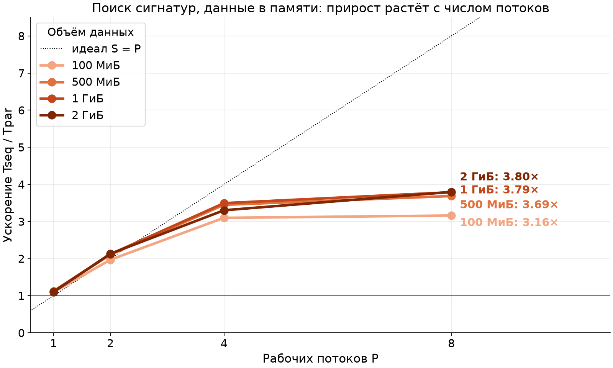
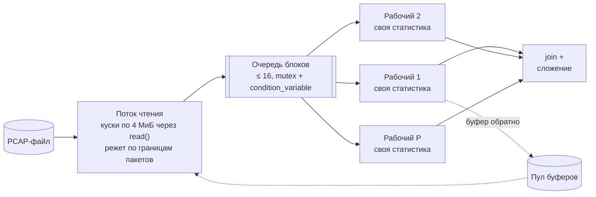
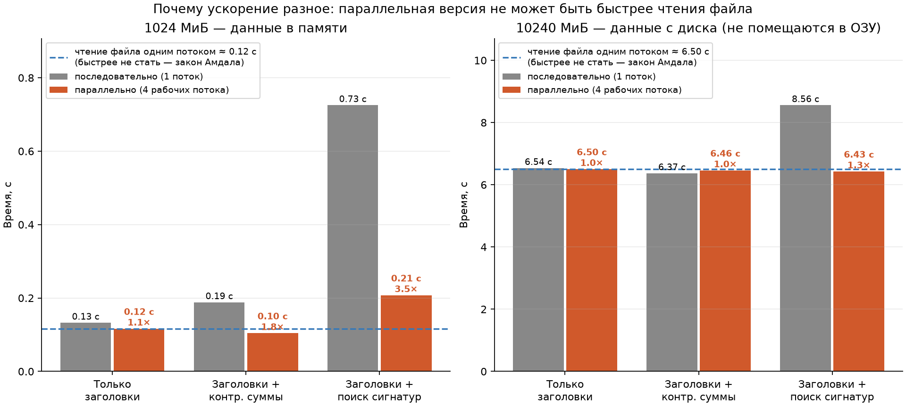
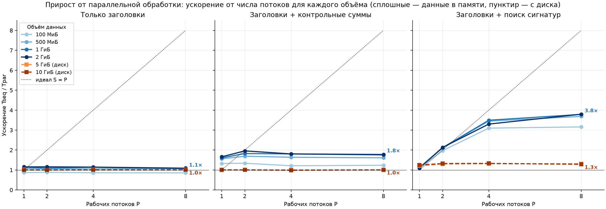
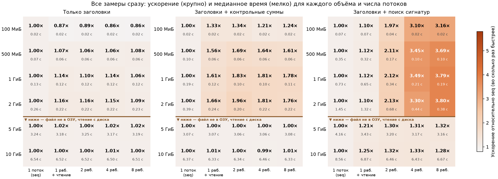
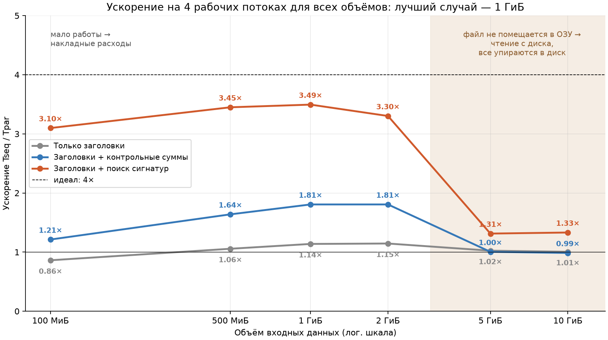
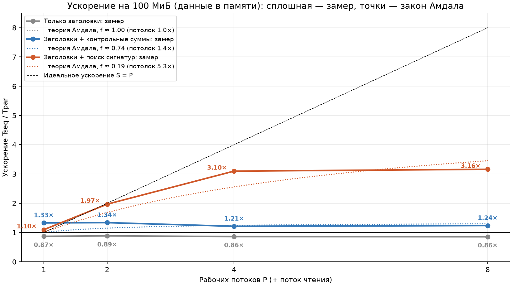
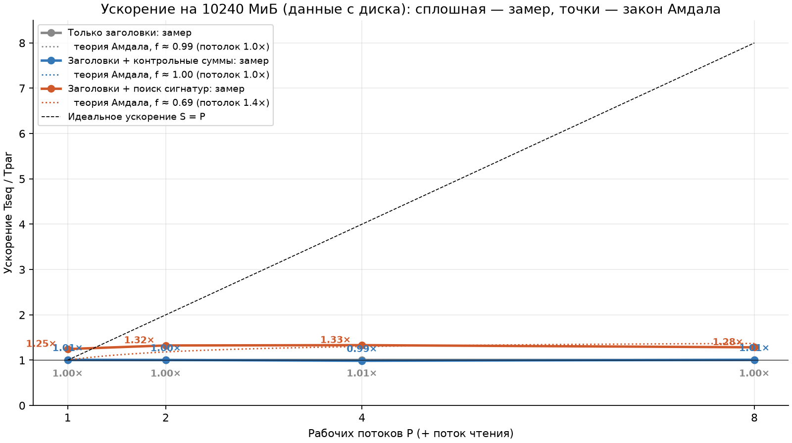
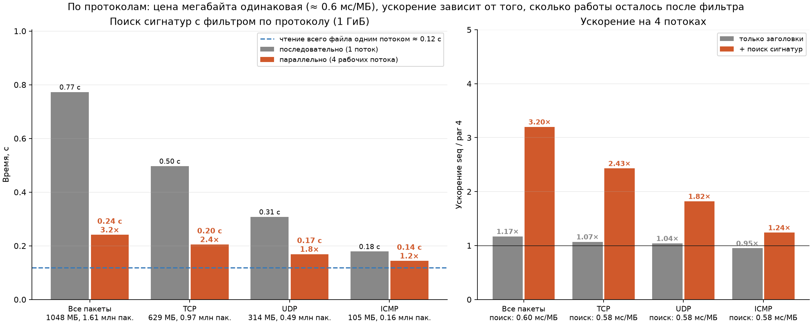

# Parallel Traffic Analyzer

**Параллельный анализатор сетевого трафика на C++.** Читает PCAP-файл, разбирает заголовки Ethernet / VLAN / IPv4 / TCP / UDP / ICMP, фильтрует пакеты, считает статистику по протоколам и IP-адресам, проверяет контрольные суммы и ищет сигнатуры атак в содержимом пакетов. Сравнивает последовательную и многопоточную обработку и объясняет результат по закону Амдала.


<p align="center">
  
</p>

## Главное

| | |
|---|---|
| **Данные** | синтетический PCAP ≈ 10 ГиБ, **16,2 млн пакетов**: 60% TCP, 30% UDP, 10% ICMP, 4096 IP-адресов, корректные контрольные суммы |
| **Лучшее ускорение** | **3,5× на 4 потоках, 3,8× на 8** — поиск сигнатур, 1–2 ГиБ в памяти (Apple M2, 4P + 4E ядер); рост 1,1× → 2,1× → 3,3–3,5× → 3,7–3,8× на каждом объёме от 500 МиБ до 2 ГиБ |
| **Лёгкий анализ** | только **1,1–1,8×** — упирается в последовательное чтение файла (закон Амдала) |
| **Данные с диска (5–10 ГиБ)** | **1,3×** — потолок задаёт скорость SSD (≈ 1,6 ГБ/с) |
| **Корректность** | 10 групп тестов; во всех **450** замерах статистика параллельной версии совпала с последовательной (SHA-256) |

## Быстрый старт

```bash
git clone https://github.com/SERGEY-MEGA/parallel-traffic-analyzer.git
cd parallel-traffic-analyzer
make                                         # сборка (C++20, без внешних библиотек)
./generate data/traffic_10gib.pcap 10240 42  # создать тестовый файл ≈ 10 ГиБ (seed 42)
make demo                                    # тесты + пример анализа + таблица seq/par (~10 с)
```

Нужны компилятор с C++20 и Make (macOS: `clang++` из Command Line Tools; Linux: `make CXX=g++`). Python 3 — только для тестов и экспериментов. Для маленького примера хватит `./generate data/small.pcap 100 42`.

<details>
<summary>Пример вывода <code>make demo</code></summary>

```text
=== Автоматические тесты (10 групп) ===
Ran 10 tests in 0.980s -> OK

=== Тяжёлый анализ (заголовки + поиск сигнатур): 1024 МиБ, лучший из 2 запусков ===
режим       время, с  ускорение   статистика
seq            0.736      1.00x   совпадает с seq
par 1          0.646      1.14x   совпадает с seq
par 2          0.343      2.15x   совпадает с seq
par 4          0.208      3.54x   совпадает с seq
par 8          0.189      3.90x   совпадает с seq
```
</details>

## Возможности

```bash
./analyze FILE [--mode seq|par] [--threads N] [--limit-mib N]
               [--protocol tcp|udp|icmp] [--ip ADDRESS] [--port N]
               [--checksum] [--signatures] [--json]
```

| Что | Как |
|---|---|
| Разбор заголовков | Ethernet, VLAN (802.1Q / QinQ), IPv4, TCP, UDP, ICMP; проверка длин и границ перед каждым чтением |
| Фильтрация | `--protocol`, `--ip` (отправитель или получатель), `--port`; условия объединяются через «И» |
| Статистика | пакеты и байты по протоколам; по каждому IP — отправлено / получено; топ-10 адресов; полная таблица в `--json` |
| Контрольные суммы | `--checksum` — IPv4 и TCP/UDP/ICMP с псевдозаголовком, счётчик повреждённых пакетов |
| Сигнатуры атак | `--signatures` — 10 шаблонов как в простых IDS: `GET /`, `/etc/passwd`, `cmd.exe`, `<script`, `UNION SELECT`, NOP-цепочка, `\x7fELF` и др. |
| Ограничение объёма | `--limit-mib N` — анализ первых N МиБ (по границе целого пакета) |
| Живой захват | `sudo ./capture.sh en0 data/capture.pcap 10000` через `tcpdump`, затем `./analyze data/capture.pcap` |

```bash
./analyze data/traffic_10gib.pcap --mode par --threads 4 --protocol tcp --port 443
./analyze data/traffic_10gib.pcap --limit-mib 1024 --checksum --signatures
./analyze data/traffic_10gib.pcap --ip 10.0.0.1 --json
```

## Как устроен параллельный режим



- **Почему один читатель.** В PCAP нет маркеров начала пакета: граница следующего пакета известна только из длины предыдущего. Поэтому файл режет один поток, а разбор блоков идёт параллельно.
- **Без гонок данных.** Общая только очередь (и пул буферов). Статистику каждый поток копит в своей структуре, после `join` результаты складываются — блокировок на каждый пакет нет.
- **Ограниченная очередь.** Если рабочие не успевают, читатель ждёт (backpressure): 10 ГиБ не попадают в память целиком.
- `--threads 4` = 4 рабочих потока **+ поток чтения**; `seq` — один поток, чтение и анализ по очереди.

## Результаты

Apple M2 (4 производительных + 4 энергоэффективных ядра), 16 ГБ ОЗУ, `clang++ -O3`. Шесть объёмов: 100 МиБ, 500 МиБ, 1 ГиБ, 2 ГиБ, 5 ГиБ, 10 ГиБ; `seq` и `par` с 1/2/4/8 рабочими потоками, 5 повторов (медиана), три вида анализа — **450 замеров** (20 ноября 2026).

### Почему ускорение разное

<p align="center"></p>

Синяя линия — время чтения файла одним потоком. Параллельная версия не может стать быстрее неё — это последовательная часть по закону Амдала. Лёгкий анализ упирается в линию, поиск сигнатур — нет, поэтому и ускоряется в 3,5 раза. На 10 ГиБ файл не помещается в оперативную память, и линией становится скорость диска.

### Ускорение на всех объёмах и числе потоков

<p align="center"></p>

Поиск сигнатур на данных в памяти (100 МиБ – 2 ГиБ) ускоряется плавно на каждом объёме: 1 → 2 → 4 → 8 потоков дают ≈ 1,1× → 2,1× → 3,3–3,5× → 3,7–3,8×. После 4 потоков прирост меньше: у M2 только 4 производительных ядра.

| 1 ГиБ (в памяти) | seq | par 2 | par 4 | par 8 |
|---|---:|---:|---:|---:|
| только заголовки | 0,133 с | 1,10× | 1,14× | 1,06× |
| + контрольные суммы | 0,188 с | 1,83× | 1,81× | 1,78× |
| + поиск сигнатур | 0,725 с | 2,12× | **3,49×** | **3,79×** |

| 2 ГиБ (в памяти) | seq | par 2 | par 4 | par 8 |
|---|---:|---:|---:|---:|
| только заголовки | 0,256 с | 1,16× | 1,15× | 1,09× |
| + контрольные суммы | 0,393 с | 1,96× | 1,81× | 1,76× |
| + поиск сигнатур | 1,455 с | 2,13× | **3,30×** | **3,80×** |

| 10 ГиБ (с диска) | seq | par 2 | par 4 | par 8 |
|---|---:|---:|---:|---:|
| только заголовки | 6,54 с | 1,00× | 1,01× | 1,00× |
| + контрольные суммы | 6,37 с | 1,00× | 0,99× | 1,01× |
| + поиск сигнатур | 8,56 с | **1,32×** | 1,33× | 1,28× |

<details>
<summary>Тепловая карта всех 90 конфигураций и зависимость от объёма</summary>

<p align="center"></p>
<p align="center"></p>
</details>

<details>
<summary>Три случая: мало данных / лучший случай / упор в диск</summary>

| 100 МиБ — накладные расходы | 10 ГиБ — упор в диск |
|---|---|
|  |  |
</details>

### По протоколам

<p align="center"></p>

Цена поиска сигнатур одинакова для TCP, UDP и ICMP — около **0,6 мс на МБ**. Ускорение различается потому, что фильтр оставляет разный объём работы (все пакеты — 3,2×; TCP — 60% данных, 2,4×; UDP — 30%, 1,8×; ICMP — 10%, 1,2×), а файл всё равно читается целиком одним потоком.

### Закон Амдала

$$S(P) = \frac{1}{f + \frac{1-f}{P}}, \qquad S_{\max} = \frac{1}{f}$$

f — доля работы, которую выполняет один поток. Здесь это чтение файла (≈ 0,12 с на 1 ГиБ из памяти). Подобранные по замерам значения (пунктир на графиках):

| Анализ (1 ГиБ) | f | потолок 1/f | замер на 4 / 8 потоках |
|---|---:|---:|---:|
| только заголовки | 0,88 | 1,1× | 1,14× / 1,06× |
| + контрольные суммы | 0,44 | 2,3× | 1,81× / 1,78× |
| + поиск сигнатур | 0,14 | 7,4× | 3,49× / 3,79× |

**Вывод:** потоки окупаются, только когда велика доля параллельной работы. Для разбора заголовков узкое место — ввод-вывод; для тяжёлого анализа содержимого ускорение растёт с числом потоков и почти достигает числа производительных ядер (3,5× на 4). На малых объёмах (100 МиБ) выигрыш съедают накладные расходы: создание потоков, синхронизация, сложение таблиц.

Подробности — в [REPORT.md](REPORT.md).

## Проверка правильности

- `make test` — 10 групп тестов на пакетах с заранее известным ответом: фильтры, VLAN, IP-фрагменты, обрезанные пакеты, повреждённые файлы, оба порядка байтов PCAP, наносекундные метки, контрольные суммы, поиск сигнатур, ошибочные аргументы. В каждом тесте результат `seq` сравнивается с `par` на 1, 2, 4 и 8 потоках.
- В экспериментах для каждого запуска сравнивается SHA-256 **полной** статистики (все протоколы и все 4096 IP-адресов) с последовательной — совпадение во всех 450 замерах.

## Структура проекта

```text
analyze.cpp        анализатор: разбор, фильтры, статистика, seq / par
generate.cpp       генератор синтетического PCAP (воспроизводимый по seed)
common.h           чтение чисел из байтов, IP-адреса, контрольная сумма
tests.py           автоматические тесты (make test)
benchmark.py       серия замеров с проверкой совпадения статистики
plot.py            графики одной серии
plot_compare.py    сравнительные графики и подбор f по Амдалу
demo.py            демонстрация (make demo)
capture.sh         захват реального трафика через tcpdump
REPORT.md          отчёт: алгоритм, эксперимент, результаты
results/           главные графики
results/данные/    исходные замеры (CSV, JSON) трёх серий и по протоколам
results/дополнительно/      сравнение на 500 МиБ, 2 ГиБ и 5 ГиБ
results/v1_старая_версия/   первая версия (до ускорения чтения)
```

## Повторить эксперимент

```bash
S="--sizes 100 500 1024 2048 5120 10240 --repeats 5"
python3 benchmark.py data/traffic_10gib.pcap $S              --out results/данные/v2_basic
python3 benchmark.py data/traffic_10gib.pcap $S --checksum   --out results/данные/v2_checksum
python3 benchmark.py data/traffic_10gib.pcap $S --signatures --out results/данные/v2_signatures

python3 -m venv .venv && .venv/bin/pip install -r requirements-plots.txt
.venv/bin/python plot_compare.py results
```

Каждая серия — около 5 минут. Перед каждым объёмом выполняется прогрев, порядок конфигураций перемешивается, кэш ОС не очищается. Время измеряется внутри анализатора (без печати результата).

<details>
<summary>Детали формата и ограничения</summary>

- Классический PCAP 2.4 с Ethernet, оба порядка байтов, микро- и наносекундные метки времени. PCAPNG и другие типы канального уровня не поддерживаются.
- Категории пакетов: `Selected` — попали в статистику, `Filtered` — не прошли фильтр, `Invalid` — неполные или ошибочные заголовки, `Unsupported` — не IPv4 (ARP, IPv6). Сумма равна `Packets`.
- Байты — исходная длина Ethernet-кадра. Для пакета между двумя адресами байты учитываются и у отправителя, и у получателя.
- Фрагменты IPv4 не собираются; при фильтре по порту фрагменты без транспортного заголовка не проходят.
- Генератор: кадры 64 / 128 / 512 / 1024 / 1514 байт, адреса `10.0.0.1` – `10.0.16.0`, корректные контрольные суммы; полезная нагрузка синтетическая (сигнатур в ней нет — их обнаружение проверяют тесты).
- Формат PCAP: [документация libpcap](https://github.com/the-tcpdump-group/libpcap/blob/master/pcap-savefile.manfile.in).
</details>
