# Разработка параллельной системы анализа сетевого трафика

## Цель работы

Разработать программу, которая читает сетевые пакеты из PCAP, разбирает заголовки, фильтрует пакеты и собирает статистику. Сравнить последовательное выполнение с параллельным на разных объёмах данных и при разном числе рабочих потоков.

Работа выполнена в две итерации. В первой версии (разделы ниже до «Версии 2», результаты в `results/v1_старая_версия/`) ускорения почти не было: узким местом оказался последовательный поток чтения. Во второй версии чтение ускорено примерно вдвое и добавлены две более тяжёлые операции анализа — проверка контрольных сумм и поиск сигнатур в нагрузке. На тяжёлом анализе получено ускорение **4,3× на 4 потоках и 5,6× на 8** (1 ГиБ в файловом кэше); на данных с диска — **2,3×**. Итоговые результаты — в разделе «Версия 2».

## Какие данные анализируются

PCAP — файл с сохранёнными сетевыми пакетами. Сначала идёт общий заголовок размером 24 байта, затем записи: 16 байт служебного заголовка и захваченные байты одного пакета. Поля заголовка записи позволяют узнать длину пакета и перейти к следующему. Формат сверялся с [описанием libpcap](https://github.com/the-tcpdump-group/libpcap/blob/master/pcap-savefile.manfile.in).

В каждом пакете программа разбирает Ethernet, при наличии — VLAN, затем IPv4. Из IPv4 берутся адреса отправителя и получателя и номер протокола. Для TCP и UDP дополнительно читаются порты. Программа проверяет границы перед чтением полей, чтобы не выйти за пределы захваченных данных.

Считаются пакеты и байты по протоколам и IP-адресам. Для IP отдельно учитываются отправленные и полученные пакеты. Есть фильтры по протоколу, адресу и порту. Они работают и в последовательном, и в параллельном режиме.

Для получения реального PCAP предусмотрен скрипт `capture.sh`, который вызывает `tcpdump` на выбранном пользователем интерфейсе. Самостоятельный драйвер захвата не разрабатывался. Для эксперимента живой захват не нужен: используется воспроизводимый синтетический файл.

## Генератор

Создан файл `data/traffic_10gib.pcap`:

- размер: **10 737 417 294 байта**, то есть почти 10 ГиБ;
- количество пакетов: **16 163 706**;
- TCP: **9 696 373**;
- UDP: **4 849 549**;
- ICMP: **1 617 784**;
- seed: **42**;
- число возможных IP-адресов: **4096**.

Протоколы выбираются с вероятностями 60%, 30% и 10%. Поэтому точные количества немного отличаются от этих долей. Размеры Ethernet-кадров: 64, 128, 512, 1024 и 1514 байт. Контрольные суммы заголовков и транспортных протоколов корректны. Полезные данные заполнены синтетическими байтами; настоящие сеансы TCP и сообщения приложений не моделируются.

Файл создан генератором, а не заполнен нулями до нужного размера. В нём находятся настоящие записи PCAP. Первые пакеты дополнительно прочитаны внешней программой `tcpdump`; она распознала Ethernet/IPv4 и подтвердила проверенные TCP/UDP-суммы. Это выборочная внешняя проверка, а не проверка всех 16 миллионов пакетов.

## Последовательный алгоритм

1. Открыть PCAP и проверить общий заголовок.
2. Прочитать блок целых записей.
3. По очереди разобрать пакеты из блока.
4. Проверить условия фильтра.
5. Обновить счётчики протоколов и словарь IP.
6. Повторять до конца файла или заданного объёма.

Всё выполняется одним потоком. Словарь `unordered_map` обычно позволяет найти статистику IP за ожидаемое постоянное время. Программа просматривает записи один раз. Работа чтения зависит от числа байтов B, работа разбора — от количества пакетов N. Ожидаемая сложность обработки — O(B + N). Поиск топ-адресов для вывода выполняется отдельно, после измерения.

## Возможности распараллеливания

Разбор одного пакета не зависит от разбора предыдущего: адреса, протокол и длины находятся в самом пакете. Поэтому разные блоки можно передать разным потокам.

Просто поделить PCAP на равные диапазоны байтов нельзя: граница может попасть в середину пакета. В этой реализации один читатель проходит по заголовкам записей и собирает блоки из целых пакетов. Чтение и определение границ остаются последовательными.

Общий словарь IP с мьютексом на каждый пакет был бы точкой конкуренции потоков. Поэтому рабочие потоки считают локальные результаты, а главный поток складывает их в конце. Это уменьшает синхронизацию, но требует дополнительных словарей и времени на объединение.

## Параллельный алгоритм

```text
                     ┌→ рабочий 1 → своя статистика ─┐
читатель → очередь ──┼→ рабочий 2 → своя статистика ─┼→ объединение
                     └→ рабочий P → своя статистика ─┘
```

Блок ограничен 4096 записями или примерно 4 МиБ. Очередь ограничена: для больших потоков данных не растёт потребление памяти. Рабочий поток забирает свободный блок целиком, поэтому быстрый поток может обработать больше блоков, чем медленный.

Для очереди используются `mutex` и `condition_variable`. Условная переменная позволяет спать, когда блоков нет или очередь заполнена, вместо постоянной проверки в цикле. После чтения последнего блока очередь закрывается. Потоки дорабатывают оставшиеся блоки, главный поток вызывает `join` и объединяет счётчики.

`par 4` означает четыре рабочих потока **и ещё один главный поток чтения**. В `par 1` тоже два потока: один читает, другой анализирует. Таким образом, это конвейер, а не то же самое, что последовательное выполнение.

Файл целиком в память не загружается. Память зависит от вместимости очереди и блоков, числа потоков и числа уникальных IP. В худшем случае локальные таблицы могут содержать одни и те же адреса у всех P потоков: O(P × U), где U — число уникальных IP. Ожидаемая работа объединения — O(P × U). Потоки не выполняют разбор полезных данных приложений и повторную проверку контрольных сумм.

## Условия эксперимента (версия 1)

Измерения выполнены 10 ноября 2026 года. Система: `macOS-26.6.2-arm64-arm-64bit`, архитектура `arm64`, логических CPU: **8**. Компилятор: `Apple clang version 21.0.0 (clang-2100.3.34.2)`. Сборка: `-std=c++20 -O3 -Wall -Wextra -Wpedantic -pthread`.

Тестировались объёмы 100 МиБ, 500 МиБ, 1 ГиБ, 5 ГиБ и 10 ГиБ. Использованы префиксы одного файла: входы заканчиваются на целой записи, поэтому их фактические размеры могут быть немного меньше заданных. Это сравнение объёмов одного распределения трафика, а не пяти разных сетевых сценариев.

Для каждого объёма запускались последовательный режим и параллельный с 1, 2, 4, 8 рабочими потоками. Каждая конфигурация измерялась три раза, итог — медиана. Всего **75 измеренных запусков**, дополнительно пять последовательных прогревов. Порядок конфигураций внутри повтора перемешивался с seed 42. Конфигурации не запускались одновременно.

Таймер `steady_clock` охватывает открытие файла, чтение, создание потоков, анализ, ожидание завершения и объединение статистики. Генерация PCAP и печать результата исключены. Внешнее время запуска тоже сохранено, но таблицы ниже используют внутреннее время анализа.

Перед серией для каждого объёма выполнен один прогрев. Кэш ОС не очищался; гарантировать одинаково холодный или одинаково прогретый кэш всех входов нельзя. Замеры характеризуют запуск на этой машине в этих условиях. Трёх повторов недостаточно, чтобы считать небольшую разницу доказанным устойчивым преимуществом.

## Результаты версии 1

Медианное время в секундах:

| Объём, МиБ | seq | par 1 | par 2 | par 4 | par 8 |
|---|---:|---:|---:|---:|---:|
| 100 | 0.0204 | 0.0206 | 0.0211 | 0.0221 | 0.0233 |
| 500 | 0.0945 | 0.0946 | 0.0988 | 0.1022 | 0.1050 |
| 1024 | 0.2021 | 0.1890 | 0.1997 | 0.2108 | 0.2108 |
| 5120 | 3.2656 | 3.2808 | 3.0903 | 3.0955 | 3.0797 |
| 10240 | 6.3929 | 6.1650 | 6.2555 | 6.1483 | 6.2679 |

Ускорение S = Tseq / Tpar. Если S > 1, параллельный вариант быстрее; если S < 1 — медленнее:

| Объём, МиБ | par 1 | par 2 | par 4 | par 8 |
|---|---:|---:|---:|---:|
| 100 | 0.990 | 0.965 | 0.922 | 0.876 |
| 500 | 0.999 | 0.956 | 0.924 | 0.899 |
| 1024 | 1.069 | 1.012 | 0.959 | 0.959 |
| 5120 | 0.995 | 1.057 | 1.055 | 1.060 |
| 10240 | 1.037 | 1.022 | 1.040 | 1.020 |

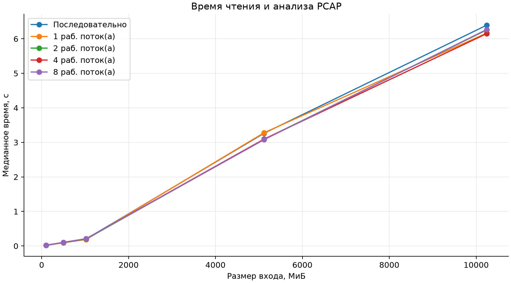

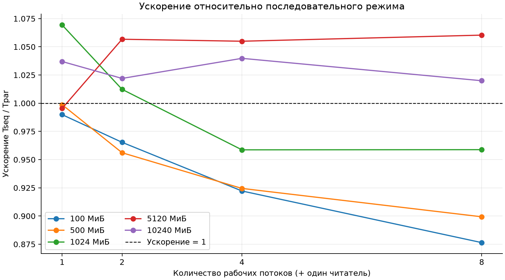

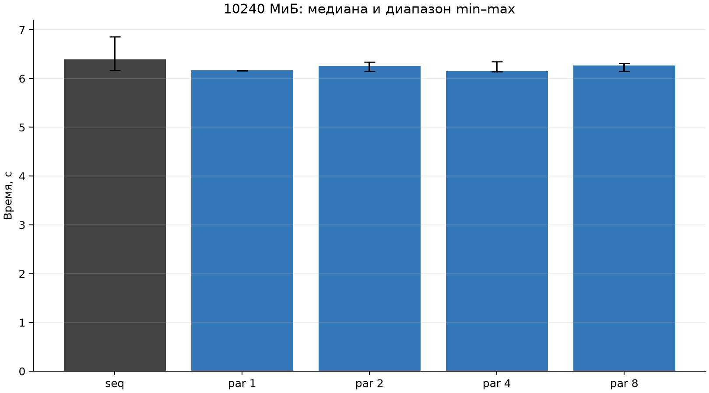

Эффективность в `summary.csv` вычисляется по формуле E = S / P, где P — число рабочих потоков. Например, для 10 ГиБ и четырёх рабочих потоков E ≈ 1,040 / 4 = 0,260, или 26%. Эта формула не включает дополнительный поток чтения; при оценке всех ресурсов нужно учитывать и его. Низкая эффективность здесь показывает слабое масштабирование по рабочим потокам.

## Объяснение результатов версии 1

На 100 и 500 МиБ последовательный вариант быстрее всех измеренных параллельных конфигураций. Работа с отдельным пакетом короткая, поэтому запуск потоков, передача блоков и объединение результатов могут стоить дороже, чем сэкономленное время разбора.

На 1 ГиБ самый быстрый вариант — один рабочий поток плюс читатель, около 0,189 с. На 5 ГиБ лучший результат у восьми рабочих потоков, около 3,080 с. На 10 ГиБ лучший результат у четырёх рабочих потоков, около 6,148 с против 6,393 с последовательно: ускорение примерно **1,04 раза**. Дополнительные рабочие потоки не дают последовательного роста скорости.

Важно учитывать разброс: на 10 ГиБ последовательные запуски заняли 6,167–6,859 с, а `par 4` — 6,143–6,345 с. Диапазоны пересекаются, и разница медиан небольшая. Поэтому результат нельзя описывать как уверенное многократное ускорение.

Вероятное объяснение слабого масштабирования — последовательное чтение и подготовка блоков при дешёвом разборе заголовков. Если читатель не успевает выдавать блоки, дополнительные рабочие потоки ждут. Также влияют очередь, выделение памяти, объединение таблиц и кэш ОС. Отдельных замеров времени этих этапов и профилирования диска не проводилось, поэтому вклад каждого фактора точно не установлен.

Пропускная способность при переходе от 1 к 5 ГиБ заметно снижается. Это согласуется с влиянием файлового кэша, но не доказывает его единственную причину. Сравнивать эти числа с паспортной скоростью диска напрямую нельзя.

Согласно закону Амдала, ускорение ограничивается последовательной частью: S(P) ≤ 1 / (f + (1 − f) / P), где f — доля последовательной работы в упрощённой модели. В данном проекте чтение и сборка блоков не распределяются между рабочими потоками. Из-за конвейера и меняющихся условий ввода-вывода подставлять результаты в эту формулу для точного вычисления f было бы некорректно; она объясняет само ограничение.

## Версия 2: ускоренное чтение и тяжёлый анализ

### Что изменено

1. **Чтение.** В v1 читатель вызывал `ifstream::read` для каждой записи — 1,6 млн вызовов на 1 ГиБ — и выделял новый буфер на каждый блок. Теперь он читает файл кусками по 4 МиБ одним системным вызовом `read()` и проходит только по 16-байтовым заголовкам записей, обрезая кусок на границе последнего целого пакета (хвост переносится в следующий блок). Пустые буферы рабочие потоки возвращают в пул, читатель использует их снова. Отдельный замер: чтение 1 ГиБ из кэша ≈ 0,13 с против ≈ 0,27 с в v1. Пробовался также `mmap`, но на macOS он оказался медленнее (≈ 0,4 с на 1 ГиБ из-за обработки страничных прерываний в потоке чтения), поэтому не используется.
2. **`--checksum`** — проверка контрольных сумм IPv4 и TCP/UDP/ICMP с псевдозаголовком; число пакетов с ошибкой выводится в статистике.
3. **`--signatures`** — поиск 10 сигнатур подозрительного содержимого в полезной нагрузке (`GET /`, `/etc/passwd`, `cmd.exe`, `<script`, `UNION SELECT`, NOP-цепочка `0x90×8`, `\x7fELF` и др.), как в простых системах обнаружения вторжений. Для каждого байта нагрузки по таблице первых байтов выбираются кандидаты, затем сравнивается сигнатура целиком. Это операция, где вычислений на байт много больше, чем на чтение.

Тестов стало 10: добавлены проверка обнаружения испорченных контрольных сумм и поиск сигнатур на пакетах с известным содержимым (включая неполную и обрезанную сигнатуру и работу вместе с фильтром).

### Условия

Та же машина (Apple M2: 4 производительных + 4 энергоэффективных ядра, 16 ГБ ОЗУ), тот же файл 10 ГиБ, те же объёмы (100 МиБ … 10 ГиБ), `seq` и `par` с 1, 2, 4, 8 рабочими потоками, 3 повтора, медиана, прогрев перед каждым объёмом. Три серии: без доп. операций (`results/данные/v2_basic`), с `--checksum` (`results/данные/v2_checksum`), с `--signatures` (`results/данные/v2_signatures`). Всего **225 замеров; статистика (SHA-256 полной таблицы) совпала с последовательной во всех 225**.

### Результаты: медианное время, с, и ускорение S = Tseq / Tpar

1 ГиБ (данные в файловом кэше ОС):

| Анализ | seq | par 1 | par 2 | par 4 | par 8 |
|---|---:|---:|---:|---:|---:|
| только заголовки | 0,215 | 0,133 (1,62×) | 0,133 (1,61×) | 0,134 (1,60×) | 0,148 (1,45×) |
| + контрольные суммы | 0,301 | 0,183 (1,65×) | 0,128 (2,35×) | 0,130 (2,32×) | 0,140 (2,15×) |
| + поиск сигнатур | 1,278 | 1,113 (1,15×) | 0,567 (2,25×) | 0,299 (**4,27×**) | 0,228 (**5,62×**) |

10 ГиБ (не помещается в кэш, чтение с SSD ≈ 1,6 ГБ/с):

| Анализ | seq | par 1 | par 2 | par 4 | par 8 |
|---|---:|---:|---:|---:|---:|
| только заголовки | 6,32 | 6,28 (1,01×) | 6,21 (1,02×) | 6,28 (1,01×) | 6,26 (1,01×) |
| + контрольные суммы | 6,22 | 6,16 (1,01×) | 6,14 (1,01×) | 6,15 (1,01×) | 6,13 (1,02×) |
| + поиск сигнатур | 14,10 | 11,23 (1,26×) | 6,09 (**2,31×**) | 6,10 (2,31×) | 6,13 (2,30×) |

Полные таблицы для всех объёмов: `results/данные/v2_*/summary.csv`, сводка — `results/дополнительно/compare.csv`.

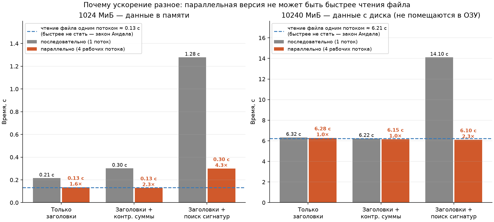

На графике выше серые столбики — последовательный режим, оранжевые — 4 рабочих потока, синяя линия — время чтения файла одним потоком (лучший результат лёгкого анализа: сам анализ там почти бесплатный). Параллельная версия не может стать быстрее этой линии — это последовательная часть по Амдалу. Лёгкий анализ упирается в неё, тяжёлый (поиск сигнатур) — нет, поэтому и ускоряется в 4,3 раза. На 10 ГиБ линией становится скорость чтения с диска (≈ 6,2 с).

На графиках ниже сплошные линии — замер, пунктир того же цвета — закон Амдала с подобранной долей f, чёрная диагональ — идеальное ускорение S = P.

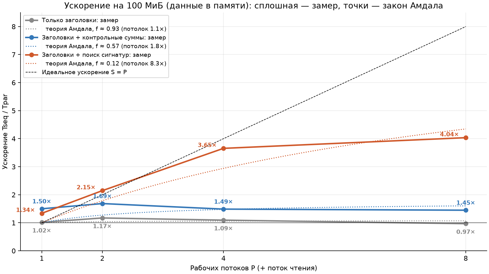

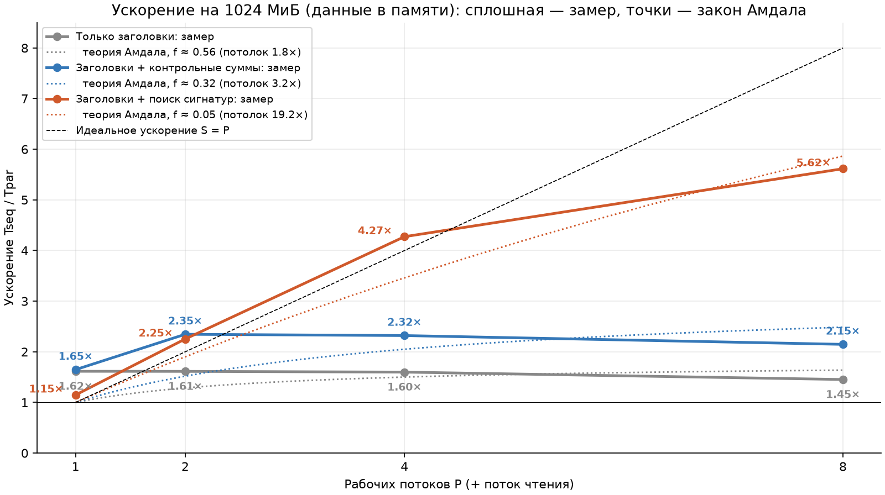

Ускорение на 4 рабочих потоках для всех объёмов: растёт до 1 ГиБ (меньше доля накладных расходов), а на 5 и 10 ГиБ падает — файл не помещается в ОЗУ, и все варианты упираются в скорость диска.

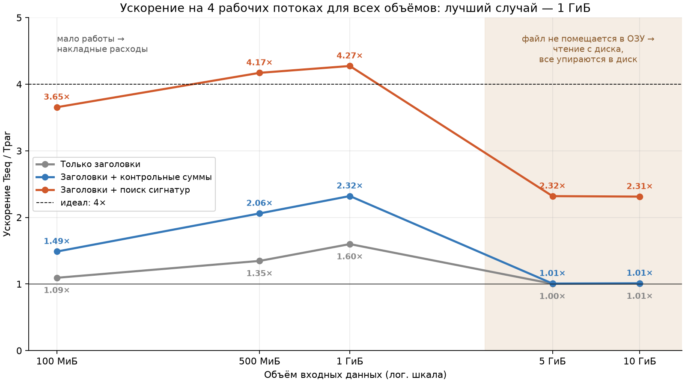

Все 75 конфигураций версии 2 на одной картинке: для каждого вида анализа таблица «объём × число потоков», в клетке ускорение и медианное время. Чем темнее клетка, тем больше прирост от параллельной обработки.

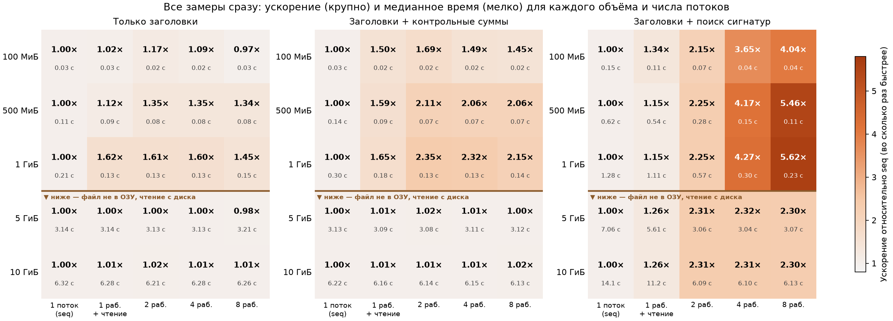

Те же данные линиями: ускорение от числа потоков для каждого объёма (сплошные — данные в памяти, пунктир — с диска; точечная диагональ — идеальное ускорение).

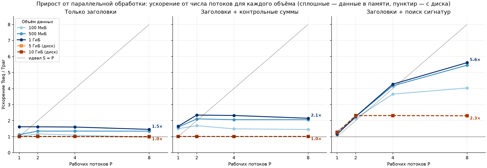

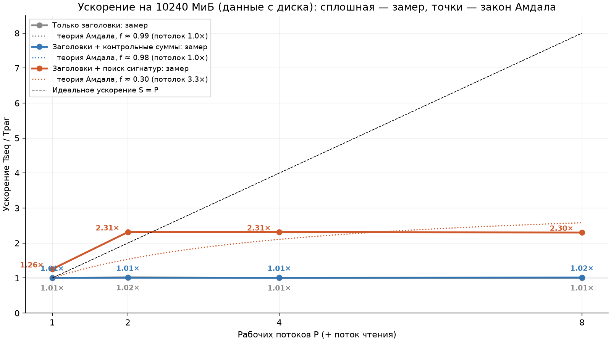

### Замер по протоколам

Отдельно на 1 ГиБ (лучший из 3 запусков) сравнены `seq` и `par 4` с фильтром `--protocol` (`results/данные/protocols.csv`); статистика совпала во всех вариантах.

| Фильтр | Пакетов | МБ | Заголовки: seq → par 4 | Сигнатуры: seq → par 4 |
|---|---:|---:|---|---|
| все | 1 614 642 | 1048 | 0,179 → 0,133 с (1,35×) | 1,237 → 0,308 с (4,02×) |
| TCP | 968 029 | 629 | 0,167 → 0,133 с (1,26×) | 0,798 → 0,231 с (3,46×) |
| UDP | 485 087 | 314 | 0,162 → 0,133 с (1,22×) | 0,473 → 0,200 с (2,36×) |
| ICMP | 161 526 | 105 | 0,153 → 0,135 с (1,14×) | 0,260 → 0,156 с (1,67×) |

Стоимость поиска сигнатур на мегабайт отобранных данных одинакова для всех протоколов: (T_seq − T_заголовки) / МБ ≈ 1,0 мс/МБ для TCP, UDP и ICMP. Сам протокол на скорость не влияет. Ускорение различается потому, что фильтр уменьшает объём тяжёлой работы, а чтение файла (≈ 0,13 с, один поток) остаётся тем же: чем меньше пакетов проходит фильтр, тем больше доля последовательной части f и тем меньше ускорение — опять закон Амдала.

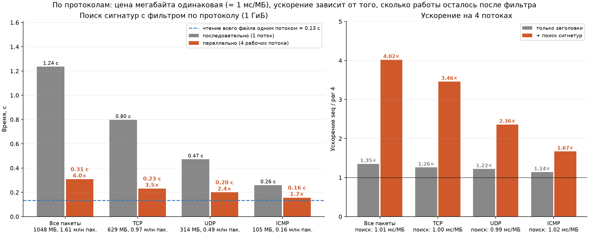

### Объяснение и закон Амдала

Закон Амдала: S(P) = 1 / (f + (1 − f) / P), где f — доля работы, которая выполняется последовательно. В программе последовательная часть — поток чтения (чтение файла и поиск границ записей), а параллельная — разбор и анализ пакетов. Для каждой серии f подобрана по замерам методом наименьших квадратов (`plot_compare.py`, пунктир на графике):

| Анализ (1 ГиБ) | f | предел S при P → ∞ = 1/f |
|---|---:|---:|
| только заголовки | ≈ 0,56 | ≈ 1,8 |
| + контрольные суммы | ≈ 0,32 | ≈ 3,1 |
| + поиск сигнатур | ≈ 0,05 | ≈ 19 |

Эти значения согласуются с отдельными замерами: чтение 1 ГиБ занимает ≈ 0,13 с, а весь последовательный анализ — 0,215 / 0,301 / 1,278 с, то есть доля чтения ≈ 0,6 / 0,43 / 0,10. Чем больше вычислений приходится на байт, тем меньше f и тем лучше масштабирование. Лёгкий анализ упирается в чтение уже при одном–двух рабочих потоках: дальше потоки простаивают в ожидании блоков.

Наблюдения:

- **Три режима работы.** (1) Лёгкий анализ — ограничен чтением (≈ 1,6×). (2) Тяжёлый анализ при данных в кэше — масштабируется: 2,25× на 2 потоках, 4,27× на 4, 5,62× на 8. (3) Данные с диска — все варианты упираются в скорость SSD (≈ 6,1 с на 10 ГиБ), и даже тяжёлый анализ даёт только 2,3×: время чтения с диска становится последовательной частью (подобранная f ≈ 0,3).
- **4,27× на 4 потоках — больше 4.** `par 4` — это 4 рабочих потока *плюс* поток чтения, а `seq` читает и анализирует по очереди. Время чтения в параллельной версии перекрывается анализом (конвейер), поэтому по отношению к `seq` выходит чуть больше P.
- **От 4 к 8 потокам прирост меньше (4,27× → 5,62×).** У M2 только 4 производительных ядра; энергоэффективные ядра медленнее примерно в 2–3 раза, и одно ядро занято читателем.
- **Накладные расходы.** На 100 МиБ лёгкий анализ даёт 1,0–1,17×, а `par 8` медленнее `seq` (0,97×): время создания потоков, синхронизации очереди и слияния восьми таблиц IP сравнимо со всей работой (≈ 25 мс). Эффективность E = S / P для тяжёлого анализа: 1,13 (P = 2), 1,07 (P = 4), 0,70 (P = 8) — для лёгкого не выше 0,81 и быстро падает.
- **Корректность.** Во всех 225 запусках полная статистика совпала с последовательной; синхронизация нужна только для очереди и пула буферов, статистика копится в локальных структурах потоков.

Вывод: распараллеливание даёт выигрыш только тогда, когда доля параллельной работы велика. Для анализа заголовков пакетов узкое место — ввод-вывод, и его надо ускорять отдельно (быстрее читать, держать данные в памяти); для тяжёлого анализа содержимого (контрольные суммы, поиск сигнатур, DPI) многопоточность даёт ускорение, близкое к числу производительных ядер.

## Проверка правильности (версия 1)

Все **75 измеренных запусков** дали одинаковую статистику с соответствующим последовательным прогревом. Сравнивалось не только общее число пакетов: SHA-256 вычислялся от полной статистики, включая протоколы и таблицу всех IP-адресов. Время и настройки запуска исключались из сравнения.

Команда `make test` выполняет восемь групп автоматических проверок:

- точные ожидаемые счётчики на искусственно составленных пакетах и фильтры;
- оба порядка байтов PCAP и оба варианта точности времени;
- пустой файл PCAP и частично захваченные пакеты;
- обработка фрагментов без сборки исходного пакета;
- повреждения структуры файла и неподдерживаемый канальный уровень;
- некорректные длины заголовков;
- ошибочные аргументы командной строки;
- генератор, несколько блоков, ограничение объёма и воспроизводимость seed.

На тестовом файле генератора размером 8 МиБ отдельный код Python также пересчитывает контрольные суммы IPv4 и транспортных протоколов. Это независимая проверка генератора. Последовательный и параллельный анализ используют общую функцию разбора, поэтому одно только совпадение двух режимов не доказывало бы правильность этой функции; для этого и нужны пакеты с заранее известными ответами.

## Ограничения и возможное развитие

Поддерживаются классический PCAP с Ethernet и заголовки IPv4. Для PCAPNG, IPv6, анализа HTTP/DNS и восстановления TCP-потоков потребуется отдельная реализация. Захват делегирован `tcpdump`, а не встроен в C++-программу. Синтетические данные не воспроизводят все особенности реальной сети.

Для следующей версии можно отдельно измерить время чтения и разбора, уменьшить копирование блоков, добавить повторную проверку контрольных сумм как полезную более тяжёлую операцию и проверить несколько распределений пакетов. Такие изменения стоит оценивать новыми экспериментами, а не ожидать ускорения только от увеличения числа потоков.

## Что сказать на защите

Ниже текст по версии 1; итог по версии 2 — в выводе раздела «Версия 2».

«Я сделал анализатор PCAP на C++. Он разбирает Ethernet и IPv4, считает пакеты и байты по протоколам и IP-адресам, умеет фильтровать по адресу, протоколу и порту. Сначала реализовал обычную обработку в одном потоке. Затем добавил очередь блоков: главный поток читает файл, рабочие потоки анализируют разные блоки и накапливают собственную статистику. В конце результаты складываются.

Для проверки я сгенерировал почти 10 ГиБ корректных записей PCAP и сравнил оба режима на пяти размерах входа и четырёх количествах рабочих потоков. Статистика совпала во всех 75 замерах. На небольших файлах параллельный вариант медленнее, на большом выигрыш около четырёх процентов. Выраженного масштабирования нет: чтение остаётся последовательным, а анализ заголовков сам по себе лёгкий. Это показывает, что увеличение числа потоков помогает только тогда, когда достаточно большая часть работы действительно выполняется параллельно».

## Где лежат исходные результаты

Версия 2: главные графики — `results/why.png`, `results/compare_100mib.png`, `results/compare_1024mib.png`, `results/compare_10240mib.png`, `results/by_size.png`, `results/all.png`, `results/all_lines.png` и `results/protocols.png`; замеры — `results/данные/v2_basic`, `results/данные/v2_checksum`, `results/данные/v2_signatures` (в каждой та же структура, что ниже, плюс свои графики); сравнение на остальных объёмах и `compare.csv` — `results/дополнительно/`; `results/данные/generation.txt` — точные количества сгенерированных пакетов. Версия 1 — в `results/v1_старая_версия/`: `measurements.csv` — все 75 замеров, `summary.csv` — сводная таблица, `environment.json` — условия запуска и SHA-256 исходников, `stats_…mib.json` — полная статистика последовательных прогревов для каждого объёма.
